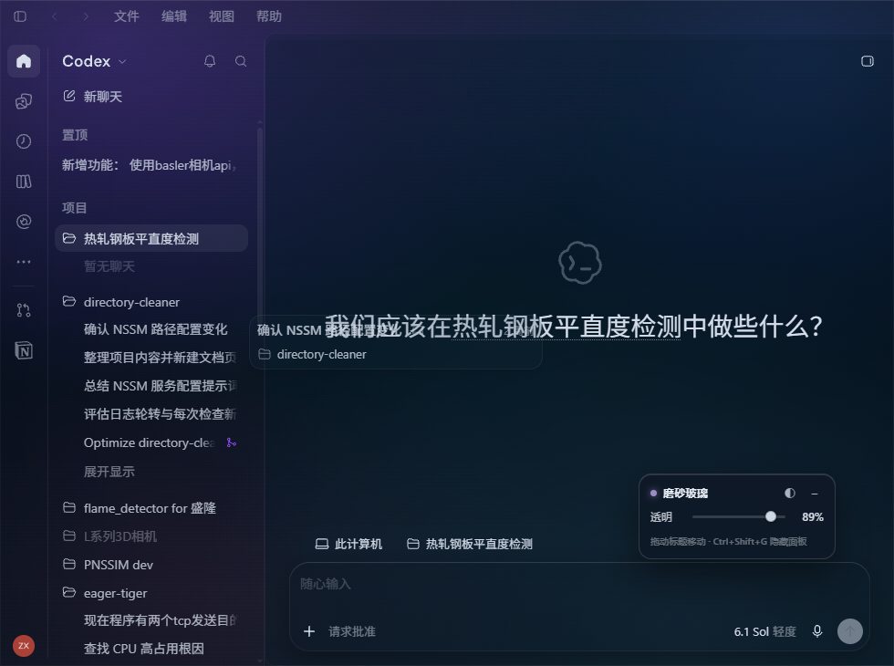
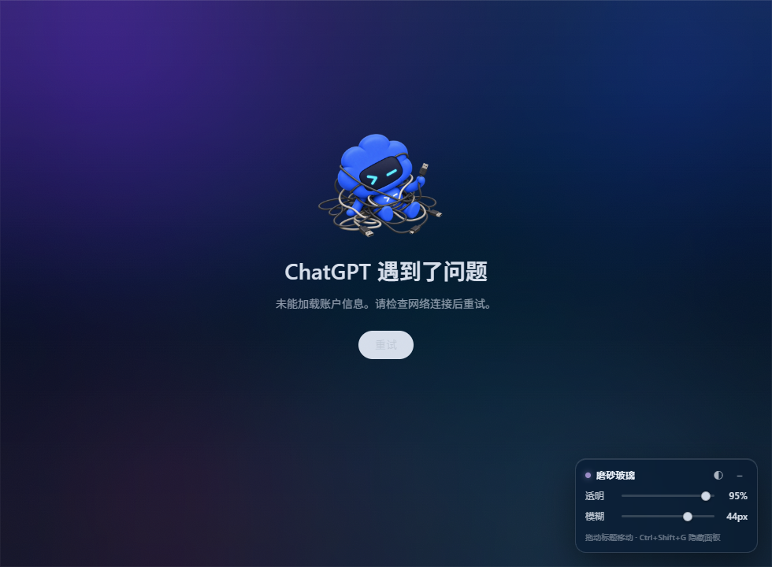
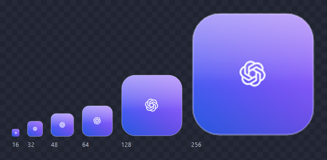
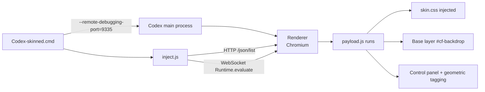

# Codex Frosted Glass

[](https://github.com/ISkywalkerI/codex-frosted-glass/releases/latest)
[](LICENSE)
[](#requirements)
[](https://nodejs.org)

A **frosted-glass skin for the [Codex](https://openai.com/codex/) desktop app** (Windows / Electron) with adjustable transparency.

No binary patching, no broken signatures, fully reversible — all styling is injected at runtime, and removing a single class restores the stock look.

> Third-party project, not affiliated with OpenAI. It only changes the local visual layer — no account, network, or data involvement.

**English** · [简体中文](README.md)



<p align="center">
  
  
</p>

---

## Features

- **Adjustable transparency** — drag a slider, the whole UI updates instantly, no reload
- **Layered depth** — shell, composer, and sidebar use three different glass thicknesses
- **Zero background processes** — double-click, launch + inject, exit. Nothing idles afterwards
- **Reversible** — toggle the `◐` button (or the `cf-off` class on `<html>`) to switch back to stock
- **Non-invasive** — no registry writes, no autostart, no services, no telemetry

## How it works



Chromium only exposes a debugging endpoint when launched with `--remote-debugging-port`. That is the one way into the renderer without touching the installed package. The injector exits once done — the skin keeps itself alive through an in-page `MutationObserver`, so no daemon is needed.

### Why not true desktop transparency

The intuitive expectation is "blur my wallpaper behind the window". That is not possible on Windows 10:

- Codex relies on Electron's `backgroundMaterial: "mica"`, and **Mica is Windows 11 only**. On Windows 10 the system ignores it and the app silently falls back to an opaque window (`html.electron-opaque`)
- I tested Windows 10's DWM acrylic (`SetWindowCompositionAttribute` — the call even reports success): **the blur does not penetrate an opaque Electron window**, the surface stays flat
- The only real fix is repacking `app.asar` to change the window flags, which breaks MSIX signing and auto-update — not worth it

So this project only does **transparency**: draw a smooth ambient gradient inside the app as the base colour, then swap the "solid surface" tokens for translucent `color-mix` values. No blur anywhere, fully reversible.

### Why there is no blur

v1.7 and v1.8 tried adding `backdrop-filter: blur()`. It was **removed in v1.9**, for three blunt reasons:

- **There is nothing behind the glass to blur.** The backdrop is a smooth gradient drawn by us, and blur only removes high-frequency detail — dragging blur from 0 to 60 changed the screen by **0.39%** on average. The slider was effectively dead.
- **The only fix was to fake it.** v1.8 stuffed a multi-scale bokeh field behind the glass so blur would have something to chew on. That meant an extra DOM layer, an extra SVG, and a full-window GPU blur — all to feed a parameter that should not exist.
- **Real desktop-through blur is impossible on Windows 10** (see above), and a full-window `blur(38px)` is exactly the most expensive thing you can do while scrolling or streaming tokens.

Verdict: **transparency only.** One less slider, one less filter, same look, zero cost.

## Requirements

| Item | Requirement |
|---|---|
| OS | Windows 10 / 11 x64 |
| Client | Codex desktop app (MSIX-packaged Electron, entry `ChatGPT.exe`) |
| Runtime | Node.js ≥ 18 (no npm dependencies) |
| Port | local `9335` (override with the `CDP_PORT` env var) |

## Quick start

**Option A — download the release** (no git needed): grab `codex-frosted-glass-v1.9.0.zip` from
[Releases](https://github.com/ISkywalkerI/codex-frosted-glass/releases/latest), extract it to a **permanent folder**, and double-click `Codex-skinned.cmd`.

**Option B — clone**:

```bat
git clone https://github.com/ISkywalkerI/codex-frosted-glass.git
```

Do not leave the folder in a temp directory — the launcher resolves `inject.js` relative to its own location.

The launcher adapts to the current state:

| State | Behaviour |
|---|---|
| Codex not running | Launches with the debug port → waits for the UI → injects → exits (~8–12 s) |
| Skinned instance already running | Re-injects immediately, exits within a second |
| Stock instance running (no port) | Asks whether to restart it; Enter to take over |
| A long-running instance | Leaves it alone, tells you what to do |

To get the **stock client**, just use Codex's own icon as usual. The two do not interfere.

### CLI

```bash
node inject.js --open      # ensure skinned launch + inject once, then exit (recommended)
node inject.js --once      # inject into the running instance only
node inject.js --restart   # force restart, then inject
node inject.js             # daemon mode: re-inject on reload/restart (stays resident)
```

## Usage

The panel is **hidden by default** so it never covers the UI. Press `Ctrl + Shift + G` to show it — after each injection a 6-second hint appears in the bottom-right corner telling you the shortcut:

| Action | Effect |
|---|---|
| Drag **Transparency** | 0% fully opaque → 100% almost fully transparent |
| Drag the title bar | Move the panel (position is remembered) |
| `◐` | Toggle the skin (turning it off restores the stock look instantly) |
| `–` | Collapse / expand the panel |
| `Ctrl + Shift + G` | Show / hide the panel (hidden by default) |

Settings live in `localStorage["cf-glass-v1"]`; default is `transparency 55%`.

## Implementation notes

### 1. Making design tokens translucent

Codex's UI is almost entirely driven by CSS variables, so instead of walking the DOM, the "solid surface" tokens are rewritten as alpha-blended colours:

```css
--color-token-main-surface-primary:
  color-mix(in srgb, #011627 calc(var(--cf-alpha) * 100%), transparent);
```

One change and every panel referencing those tokens becomes translucent. Over 20 tokens are handled (`--color-surface*`, `--app-color-background-*`, `--app-shell-*`, …).

### 2. Three thicknesses

| Layer | Treatment |
|---|---|
| Shell `#root` | base colour at 0.62 alpha — one sheet of glass across the window, plus a 1px inner top highlight |
| Composer | `alpha × 1.18` + 1px top inner highlight + drop shadow (reads as raised glass) |
| Sidebar | 1px right edge highlight; thinner and more transparent than the shell |

### 3. Geometric tagging instead of class names

Codex uses hashed class names (`ComposerLayoutBody-uBBf1A`) that change on every release, so elements are located by shape:

- **Composer**: climb up to 7 levels from `textarea` / `contenteditable`, take the first ancestor with `radius ≥ 8px, width ≥ 220, height ≥ 36`
- **Sidebar**: inside `#root`, find the element with `left ≤ 4px, height ≥ 82% viewport, width between 180 and min(520, 42% viewport)`

### 4. The maths

```js
alpha = 1 - (t / 100) * 0.94      // t=0 → 1.0 (opaque), t=100 → 0.06
```

All `color-mix` values reference it, so changing it forces a single style recalculation — which is why dragging feels instant.

## Cost

Measured across all 22 Codex processes over a 20-second window:

| State | CPU (one core) | Notes |
|---|---|---|
| Skin off | 0.16% | baseline |
| Skin on | 0.16% | **identical** — no repaint, no recompute while idle |
| Injector | a few seconds after double-click | exits when done; 0% otherwise |

With no `backdrop-filter` at all, scrolling, window dragging and token streaming never re-blur anything — the main practical win of dropping blur in v1.9.

## Known limitations

- **Reloading the page drops the skin.** Styles live in the current page, so a refresh or reopen loses them — double-click the entry again. Use daemon mode (`node inject.js`) to keep it alive automatically (about 57 MB resident)
- **The app must be launched with the debug port** for injection to work; opening it from the Start menu normally will not apply the skin (that is how Chromium works)
- No desktop transparency on Windows 10 — see above
- A major UI redesign may break the geometric tagging. The log then shows `composer× sidebar×`, and the thresholds in `payload.js` need a tweak

## Troubleshooting

| Symptom | Cause / fix |
|---|---|
| Closes instantly, or `MODULE_NOT_FOUND` | Script was moved. `cd` into the folder containing `inject.js`, or set `CF_HOME` |
| `cannot connect to Codex debug port` | Codex has been running the stock way for a while. Quit it fully and retry, or run `node inject.js --restart` |
| Injection succeeds but nothing changes | Panel may be hidden — press `Ctrl+Shift+G`; or the skin is toggled off — click `◐` |
| Text becomes unreadable | Transparency is too high; bring the slider back to 40–60% |
| Broke after a Codex update | Class names or tokens changed; check the console log |

## Layout

```
codex-frosted-glass/
├─ Codex-skinned.cmd     # one-click entry
├─ inject.js             # launcher + CDP injector
├─ payload.js            # runs in the renderer: style, panel, tagging
├─ skin.css              # all glass styling (with tunable variables)
├─ cdp.js                # minimal CDP client (debugging)
├─ capture.js            # in-renderer screenshot (ignores window occlusion)
├─ codex-skinned.ico     # gradient icon, 16–256 px
└─ docs/                 # preview images
```

## Uninstall

1. Quit Codex
2. Delete this folder
3. Injected styles vanish with the process; the client is back to stock

Nothing is written to the registry, no autostart entry, no service. To verify: `dir "%APPDATA%\Microsoft\Windows\Start Menu\Programs\Startup"` should contain nothing from this project.

## License & notices

Code released under the [MIT License](LICENSE).

- **Codex and ChatGPT are trademarks of OpenAI.** The white mark in `codex-skinned.ico` is taken from the tile assets of the locally installed client and is used solely to identify the app it launches; all trademark rights remain with OpenAI. The file can be deleted on request from the rights holder, and the icon can be replaced.
- This project contains and distributes no OpenAI program code; it only reads the renderer of the locally installed app at runtime.
- Use at your own risk.
