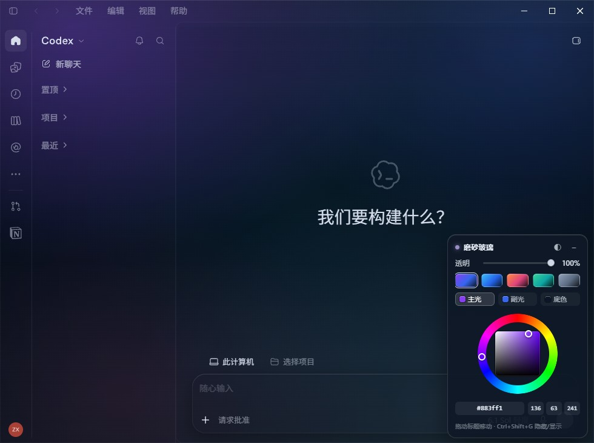
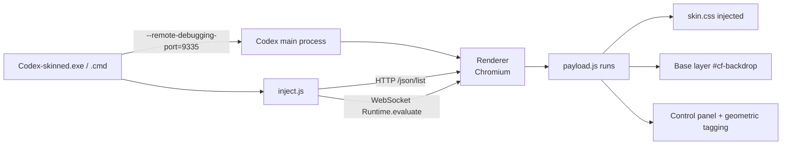
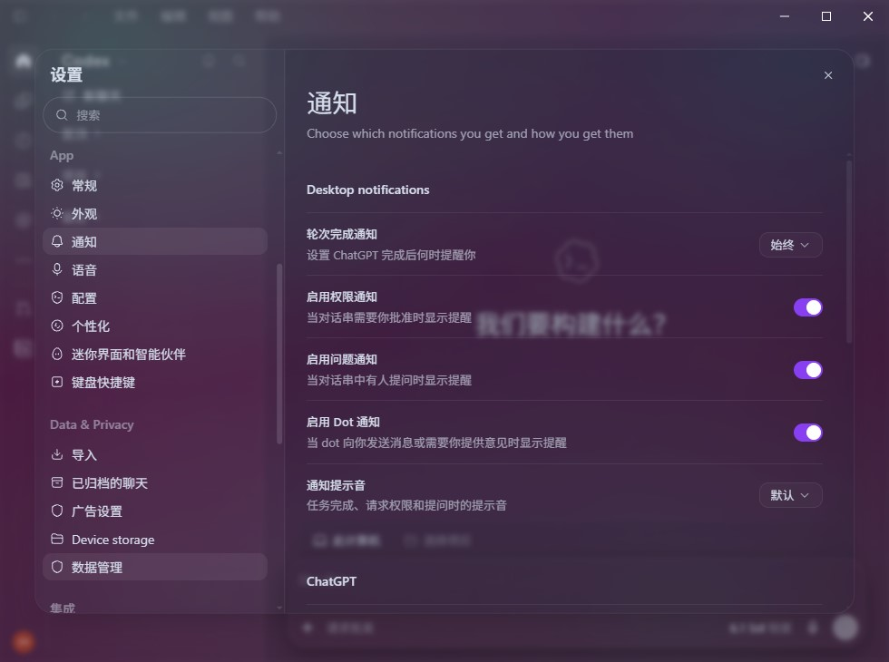

# Codex Frosted Glass

[](https://github.com/ISkywalkerI/codex-frosted-glass/releases/latest)
[](LICENSE)
[](#requirements)
[](https://nodejs.org)

A **frosted-glass skin for the [Codex](https://openai.com/codex/) desktop app** (Windows / Electron) with adjustable transparency and a built-in gradient colour picker.

No binary patching, no broken signatures, fully reversible — all styling is injected at runtime, and removing a single class restores the stock look.

> Third-party project, not affiliated with OpenAI. It only changes the local visual layer — no account, network, or data involvement.

**English** · [简体中文](README.md)



---

## Features

- **Double-click entry, two flavours** — `Codex-skinned.exe` ships with the icon embedded and no console window, so it can be pinned to Start or the taskbar; switch to `Codex-skinned.cmd` when you want the full output
- **Adjustable transparency** — drag a slider, the whole UI updates instantly, no reload
- **Pick your own gradient** — an in-panel HSV wheel drives main light / secondary light / base colour; the other three glows and the glass tint are derived. Five presets, one click each, plus a reset when you want the default back
- **Layered depth** — shell, composer, sidebar and pop-up menus use four different glass thicknesses; the composer has its own transparency slider (0–30%, default 3%) so the transcript stays out of the way while you type
- **Menus, hovers and dropdowns are all glass** — context menus, `⋯` menus, the project hover card, icon tooltips, the top menu bar (File / Edit / View / Help), the sidebar rail's fly-out card and the attachment / @ panel all share one recipe: thin base + 18px backdrop blur. Nothing is left dropping bare text on the sidebar, and no surface is left solid-dark
- **Zero background processes** — double-click, launch + inject, exit. Nothing idles afterwards
- **Reversible** — toggle the `◐` button (or the `cf-off` class on `<html>`) to switch back to stock
- **Non-invasive** — no registry writes, no autostart, no services, no telemetry

## How it works



Chromium only exposes a debugging endpoint when launched with `--remote-debugging-port`. That is the one way into the renderer without touching the installed package. The injector exits once done — the skin keeps itself alive through an in-page `MutationObserver`, so no daemon is needed.

### Why not true desktop transparency

The intuitive expectation is "blur my wallpaper behind the window". That is not possible on Windows 10:

- Codex relies on Electron's `backgroundMaterial: "mica"`, and **Mica is Windows 11 only**. On Windows 10 the system ignores it and the app silently falls back to an opaque window (`html.electron-opaque`)
- I tested Windows 10's DWM acrylic (`SetWindowCompositionAttribute` — the call even reports success): **the blur does not penetrate an opaque Electron window**, the surface stays flat
- The only real fix is repacking `app.asar` to change the window flags, which breaks MSIX signing and auto-update — not worth it

So the window itself only does **transparency**: draw a smooth ambient gradient inside the app as the base colour, then swap the "solid surface" tokens for translucent `color-mix` values. Blur is reserved for top-layer menus, where there is real content behind the glass (see below); the window body carries no filter at all and stays fully reversible.

### Where blur is used, and where it is not

v1.7 / v1.8 added `backdrop-filter: blur()` to the window and the composer; v1.9 **removed it**, because there is nothing behind the glass to blur — the backdrop is a smooth gradient we draw ourselves, and blur only removes high-frequency detail. Dragging blur from 0 to 60 changed the screen by **0.39%** on average. (v1.8 stuffed a multi-scale bokeh field behind the glass to give blur something to chew on: an extra DOM layer, an extra SVG and a full-window GPU blur, all to feed a parameter that should not exist.)

One class of surface is the exception: **top-layer overlays**. They sit on top of real content (the conversation list, the transcript), which is full of high-frequency detail — and Codex itself already uses `backdrop-filter` on that layer. The account menu is `blur(8px)`, which is exactly why it reads as the most "frosted" surface in the app. So since v1.13.5:

| Surface | What is behind it | Treatment |
|---|---|---|
| Shell / sidebar / composer | our own smooth gradient (no high frequencies) | opacity + inner highlight + shadow only |
| Menus / context menus / dropdowns / top menu bar | real content (columns of text) | thin base + `backdrop-filter: blur(18px)` |
| Hover cards / tooltips / rail fly-out / attachment panel | same — they sit on the conversation list | one rule covering all three positioning mechanisms |

The rule is not "never blur" but **don't blur where there is nothing to blur, and do blur where there is**. A full-window `blur(38px)` remains the most expensive thing you can do while scrolling or streaming tokens — that one stays out.

## Requirements

| Item | Requirement |
|---|---|
| OS | Windows 10 / 11 x64 |
| Client | Codex desktop app (MSIX-packaged Electron, entry `ChatGPT.exe`) |
| Runtime | Node.js ≥ 18 (no npm dependencies) |
| Port | local `9335` (override with the `CDP_PORT` env var) |
| Rebuilding the exe | Python 3.9+ with PyInstaller, only if you change the launcher |

## Quick start

**① Download the release** (no git needed): grab `codex-frosted-glass-v1.13.5.zip` from
[Releases](https://github.com/ISkywalkerI/codex-frosted-glass/releases/latest) and extract it to a **permanent folder**.

**② Clone the repo** (if you want to tweak or track updates):

```bat
git clone https://github.com/ISkywalkerI/codex-frosted-glass.git
```

> Do not leave the folder in a temp directory — the launcher resolves `inject.js` relative to its own location.

### Two ways to launch

Once you have the folder, there are **two entry points that do exactly the same thing** (both run `node inject.js --open`). Pick whichever fits:

| Entry | Form | When to use |
|---|---|---|
| **`Codex-skinned.exe`** (recommended) | No console window; icon and version resource are written into the PE, so it pins to Start or the taskbar | Everyday use — just double-click |
| **`Codex-skinned.cmd`** | Keeps a console window and prints the full output | Debugging; or as a fallback when the exe is blocked by security software |

#### First-run security prompts (both are normal)

- **SmartScreen**: the exe is not code-signed, so Windows shows "Windows protected your PC" → click **More info → Run anyway**. You only need to allow it once.
- **Antivirus false positives**: a few AV engines flag PyInstaller one-file builds. Whitelist the whole folder, or simply **launch with `Codex-skinned.cmd` instead** — it bypasses the exe and runs the scripts with the `node` you already have installed.
- Neither has anything to do with the skin itself: the exe contains only a few dozen lines of launcher Python, while all skin logic lives in the plain-text `inject.js` / `payload.js` / `skin.css`.

The launcher then adapts to the current state:

| State | Behaviour |
|---|---|
| Codex not running | Launches with the debug port → waits for the UI → injects → exits (~8–12 s) |
| Skinned instance already running | Re-injects immediately, exits within a second |
| Stock instance running (no port) | Asks (in a dialog) whether to restart it; Yes takes over |
| A long-running instance | Leaves it alone, tells you what to do |

To get the **stock client**, just use Codex's own icon as usual. The two do not interfere.

### CLI

```bash
node inject.js --open      # ensure skinned launch + inject once, then exit (recommended)
node inject.js --once      # inject into the running instance only
node inject.js --restart   # force restart, then inject
node inject.js             # daemon mode: re-inject on reload/restart (stays resident)
```

`Codex-skinned.exe` and `Codex-skinned.cmd` both accept these flags and pass them straight through, e.g. `Codex-skinned.exe --restart`.

## Usage

The panel is **hidden by default** so it never covers the UI. Press `Ctrl + Shift + G` to show it. **Every skinned launch** shows a 5-second hint at the top of the window telling you the shortcut, then it fades away — if the panel is already open the text switches to how to hide it, so it never tells you to summon something that is already there:

| Action | Effect |
|---|---|
| Drag **Transparency** | Overall opacity of the shell and panels: 0% fully opaque → 100% almost fully transparent (the composer has its own slider) |
| Drag **Composer** | How solid the input box is: 0% solid → 30% clearest, default 3% (≈97% base). The `?` next to it lists what each band looks like on hover / keyboard focus |
| Click one of the 5 presets | Swap the whole palette in one click (Aurora / Ocean / Sunset / Forest / Slate) |
| Click **main / alt / base** | Choose which colour the wheel edits |
| Drag the hue ring | Change hue (the ring knob follows) |
| Drag the inner square | Change saturation (horizontal) and value (vertical) |
| hex box / R G B boxes | Type exact values; an over-bright base colour is darkened automatically for legibility |
| Drag the title bar | Move the panel (position is remembered) |
| `◐` | Toggle the skin (turning it off restores the stock look instantly). Its tooltip spells out "Turn off the skin · back to the stock look" / "Turn on the skin · apply the frosted glass"; while off, an amber banner sits at the top of the panel and the colour controls below are dimmed and unclickable |
| `–` | Collapse / expand the panel |
| **Reset colours** | Return all three colours to the default Aurora in one click (transparency untouched); the button greys out when you are already on the defaults |
| `Ctrl + Shift + G` | Show / hide the panel (hidden by default; a 5-second hint appears on every launch) |

Settings live in `localStorage["cf-glass-v1"]`; the defaults are `55% transparency`, `3% composer transparency` and the Aurora palette (`#883ff1` · `#3566f0` · `#0b1728`, i.e. the v1.9 look).

**Changes save themselves.** Releasing the wheel (or clicking a preset) writes to `localStorage` straight away — there is no save button. Quit Codex, launch it skinned again, and your last transparency and palette are still there. A page reload drops the skin (see Known limitations), but one more double-click brings your own colours back.

### Not just the chat view

The skin covers the whole app — Settings, Notifications and the data pages are layered glass too, while the composer and sidebar keep their own glass thickness:



## Implementation notes

### 1. Making design tokens translucent

Codex's UI is almost entirely driven by CSS variables, so instead of walking the DOM, the "solid surface" tokens are rewritten as alpha-blended colours:

```css
--color-token-main-surface-primary:
  color-mix(in srgb, #011627 calc(var(--cf-alpha) * 100%), transparent);
```

One change and every panel referencing those tokens becomes translucent. Over 20 tokens are handled (`--color-surface*`, `--app-color-background-*`, `--app-shell-*`, …).

**One trap is worth calling out.** Codex aliases some *foreground* tokens onto a *background* token: both `--color-text-composer-primary` and `--color-text-primary-solid` resolve to `--color-background-control-opaque`. Make that "control surface" 7% transparent and the arrow on the light send button turns transparent with it — the button reads as a **blank white circle** (the bug in v1.12.2 and earlier).

So the rule is: **background tokens may be made translucent, foreground tokens may not.** Both foreground tokens are `#0b1728` in the dark theme, so they are pinned back in `skin.css`, while the 70-odd controls that use the same token *as a background* (dropdowns, popovers) stay translucent:

```css
:root:not(.cf-off) {
  --color-text-composer-primary: #0b1728;
  --color-text-primary-solid: #0b1728;
}
```

**Second trap: `backdrop-filter` does not work everywhere.** A 26px backdrop blur on the composer changed nothing; in a controlled test (base down to 18%, blur up to 30px) the transcript behind it stayed pixel-crisp — on the composer node, blur cannot rescue legibility, only opacity can. **But it does work on top-layer menus:** remove the `backdrop-filter` from an open menu and capture the same frame, and "smeared into a wash" turns straight back into "clearly readable". That is why v1.13.5 uses a thin base + blur for menus, while the composer still relies on opacity alone.

### 2. Layered thicknesses

| Layer | Treatment |
|---|---|
| Shell `#root` | base colour at 0.62 alpha — one sheet of glass across the window, plus a 1px inner top highlight |
| Composer | **its own 0–30% transparency** (default 3%, i.e. a 97% base) + 1px top inner highlight + drop shadow — a thick pane sitting on top of the transcript |
| Sidebar | 1px right edge highlight; thinner and more transparent than the shell |
| Top-layer overlays | thin base (`max(22%, alpha × 1.6)`) + `backdrop-filter: blur(18px)` + 1px inner ring + shadow — the same sheet of glass as the account menu |
| Hover cards / tooltips / top menu bar / rail fly-out / attachment panel | identical, via one rule covering `[data-anchor-positioning]`, `[data-radix-popper-content-wrapper]` and `[data-composer-overlay-floating-ui]` |

The composer is the one surface where you type *and* read at once, so it does not follow the global slider — it has its own (default 3% ≈ a 97% base, with a `?` tooltip in the panel explaining each band). At `transparency 100%` (alpha 0.06) a 7%-opaque base let the transcript bleed straight through the input area and interleave with what you were typing. Measured on a real window: 86% still left the background heading readable, 96% left faint lines, 99% was finally clean — 97% is the point where the words are gone but you can still tell it is a pane of glass. The glass read is carried by the inner highlight, the bright edge and the shadow.

### 3. Geometric tagging instead of class names

Codex uses hashed class names (`ComposerLayoutBody-uBBf1A`) that change on every release, so elements are located by shape:

- **Composer**: climb up to 9 levels from `textarea` / `contenteditable`, take the first ancestor with `radius ≥ 8px, width ≥ 220, height ≥ 36` — the composer root sits exactly 7 levels up and the old loop stopped at `hop < 7`, so it never matched
- **Sidebar**: inside `#root`, find the element with `left ≤ 4px, height ≥ 82% viewport, width between 180 and min(520, 42% viewport)`

### 4. The maths

```js
alpha = 1 - (t / 100) * 0.94      // t=0 → 1.0 (opaque), t=100 → 0.06
```

All `color-mix` values reference it, so changing it forces a single style recalculation — which is why dragging feels instant. The composer base runs on a second channel: its slider value becomes `--cf-composer-mix` (100% − transparency), referenced by the two `background-color` rules, so that slider is live too.

### 5. Gradient parameterisation and colour derivation

The backdrop is six layers: five corner glows plus one global linear gradient. You edit three colours; everything else is derived.

**The colour variables are bare `r, g, b` triples**, not hex:

```css
:root { --cf-c-main: 136, 63, 241; /* … */ }
#cf-backdrop {
  background: radial-gradient(…, rgba(var(--cf-c-main), 0.42), transparent 62%), /* … */;
}
```

That keeps the stylesheet self-sufficient (no JS still renders today's look), leaves each layer's alpha in CSS where it can be tuned individually, and matches the existing `rgb(var(--cf-tint))` convention. **Switching these to hex is the one way to break the whole backdrop at once** — `rgba(var(--x), .42)` becomes invalid at computed-value time and the entire `background` declaration falls back to `none`.

Derivation:

| Layer | Source |
|---|---|
| L1 top-left `.42` | main light, as picked |
| L2 top-right `.30` | secondary light, as picked |
| L3 bottom-right `.32` | 50/50 mix of both, forced to `s=0.30 / l=0.45` |
| L4 bottom-left `.16` | 70/30 mix, forced to `s=0.42 / l=0.50` |
| L5 centre `.06` | 30/70 mix, forced to `s=0.85 / l=0.42` |
| L6 base `.1` | picked base + two fixed offsets (`-4,-8,-12` / `-3,-4,-9`) |

Mixing with a fixed saturation/lightness (rather than rotating hues by deltas) keeps the three glows in the same family as the two lights for *any* palette. An earlier version rotated hues and produced a green glow inside the Sunset palette.

`--cf-tint` (the glass pane's own fill) is `base × 0.85 + main-offset × 0.08`, clamped to 0–60 so it always stays dark — it also fills `#root` and the composer, so a light tint would kill text contrast.

Three safety nets:
- if both lights are still the stock colours, the three glows take their original hard-coded values, so changing only the base leaves the glows untouched;
- if all three colours are stock, all ten variables are `removeProperty`'d, making the render byte-identical to v1.9;
- a base colour brighter than `L=0.30` is scaled back to 0.30 (hue and saturation preserved).

## Cost

Measured across all 22 Codex processes over a 20-second window:

| State | CPU (one core) | Notes |
|---|---|---|
| Skin off | 0.16% | baseline |
| Skin on | 0.16% | **identical** — nothing repaints while idle; picking a colour just writes 10 CSS variables on click/drag |
| Injector | a few seconds after double-click | exits when done; 0% otherwise |

The window body carries no `backdrop-filter` at all, so scrolling, window dragging and token streaming never re-blur anything — the main practical win of dropping blur in v1.9. The only blurred surfaces left are top-layer overlays (menus, the project hover card, tooltips), which exist only while open or hovered, cover a small area and never sit in the scrolling hot path.

### 6. The exe launcher

`Codex-skinned.exe` is not a wrapper around the `.cmd` — it is a small standalone program (`launcher/launcher.py`, packed into a single file with PyInstaller):

1. Locate `inject.js` (next to itself, then `CF_HOME`) and `node.exe` (`CF_NODE` → PATH → common install locations)
2. Run `node inject.js --probe` and branch **purely on the exit code** — nothing is modified
3. If Codex is running without the debug port, ask first in a dialog. A plain `.cmd` in a non-interactive context would just restart it and could throw away whatever you were typing
4. Run `node inject.js --open` for real, writing output to a log instead of a console

The probe exit codes are the contract between the launcher and `inject.js`:

| Code | Meaning | Launcher behaviour |
|---|---|---|
| 0 | Debug port reachable | inject straight away |
| 3 | Codex running, no port | ask, then add `--yes` |
| 4 | Codex not running | launch and inject |

The log lives at `%LOCALAPPDATA%\CodexSkinned\launcher.log` (overwritten each run); on failure its tail is shown in the dialog. The icon and version resource are written into the PE at build time, which is why it can be pinned to Start like a normal app — Windows treats `.cmd` as a document and offers no such option.

## Known limitations

- **Reloading the page drops the skin.** Styles live in the current page, so a refresh or reopen loses them — double-click the entry again. Use daemon mode (`node inject.js`) to keep it alive automatically (about 57 MB resident)
- **The app must be launched with the debug port** for injection to work; opening it from the Start menu normally will not apply the skin (that is how Chromium works)
- No desktop transparency on Windows 10 — see above
- A major UI redesign may break the geometric tagging. The log then shows `composer× sidebar×`, and the thresholds in `payload.js` need a tweak
- **An over-bright base colour is darkened automatically** (lightness capped at 30%), otherwise body text washes out. The hex box keeps what you typed; the colour chip shows the darkened result
- **Editing `skin.css` / `payload.js` requires re-injection**: both are read into memory as strings when the injector starts
- **The exe is unsigned**: expect a SmartScreen prompt on first run (More info → Run anyway); a few AV engines false-positive on PyInstaller one-file builds — whitelist it, or use `Codex-skinned.cmd` / `node inject.js` instead. See [Two ways to launch](#two-ways-to-launch)
- **The exe is 8.4 MB**: it bundles a Python runtime so double-clicking works on any machine; the skin itself is still a few dozen KB of CSS/JS

## Troubleshooting

| Symptom | Cause / fix |
|---|---|
| Closes instantly, or `MODULE_NOT_FOUND` | Script was moved. `cd` into the folder containing `inject.js`, or set `CF_HOME` |
| `cannot connect to Codex debug port` | Codex has been running the stock way for a while. Quit it fully and retry, or run `node inject.js --restart` |
| Injection succeeds but nothing changes | Panel may be hidden — press `Ctrl+Shift+G`; or the skin is toggled off — click `◐` |
| Text becomes unreadable | Transparency is too high; bring the slider back to 40–60% |
| Broke after a Codex update | Class names or tokens changed; check the console log |
| Colours changed but the backdrop did not | You edited `skin.css` / `payload.js` without re-running the entry point (styles are strings read at startup) |
| Panel ends up off-screen | It is clamped by its real height automatically; drag it back if needed (the position is remembered) |
| Double-clicking the exe does nothing, no dialog | Check `%LOCALAPPDATA%\CodexSkinned\launcher.log`; if there is no log either, security software blocked the exe |
| "Windows protected your PC" | Normal for an unsigned exe: More info → Run anyway |
| The send button is a blank white circle, arrow invisible | A foreground token got the translucent background treatment (see Implementation notes §1); fixed in v1.12.2 — update |
| Typed text and the transcript behind the input box blur together | Drag the **Composer** slider down (0–3% hides it, 9%+ starts showing through). Older builds have no such slider — update to v1.13.0 |

## Layout

```
codex-frosted-glass/
├─ Codex-skinned.exe      # one-click entry (icon embedded, recommended)
├─ Codex-skinned.cmd      # same thing, with a console window (debugging)
├─ inject.js              # launcher + CDP injector
├─ payload.js             # runs in the renderer: style, panel, tagging
├─ skin.css               # all glass styling (with tunable variables)
├─ cdp.js                 # minimal CDP client (debugging)
├─ capture.js             # in-renderer screenshot (ignores window occlusion)
├─ Codex-skinned_icon.ico # gradient icon, 16 / 24 / 32 / 48 / 64 / 128 / 256 px
├─ launcher/              # launcher source and build script (launcher.py / version.txt / build.cmd)
└─ docs/                  # screenshots: screenshot.jpg / screenshot2.jpg
```

## Uninstall

1. Quit Codex
2. Delete this folder
3. Injected styles vanish with the process; the client is back to stock

Nothing is written to the registry, no autostart entry, no service. To verify: `dir "%APPDATA%\Microsoft\Windows\Start Menu\Programs\Startup"` should contain nothing from this project.

## License & notices

Code released under the [MIT License](LICENSE).

- **Codex and ChatGPT are trademarks of OpenAI.** The white mark in `Codex-skinned_icon.ico` is taken from the tile assets of the locally installed client and is used solely to identify the app it launches; all trademark rights remain with OpenAI. The file can be deleted on request from the rights holder, and the icon can be replaced.
- This project contains and distributes no OpenAI program code; it only reads the renderer of the locally installed app at runtime.
- Use at your own risk.
