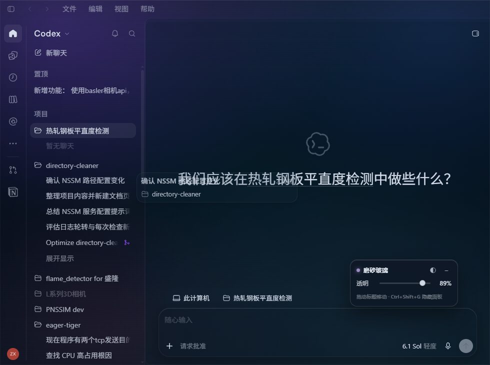
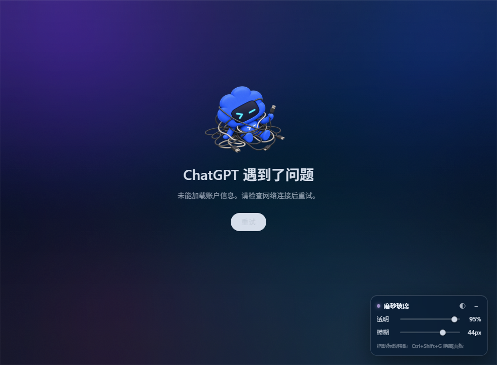
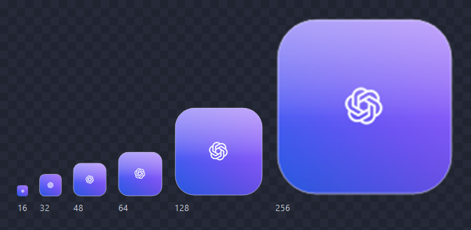
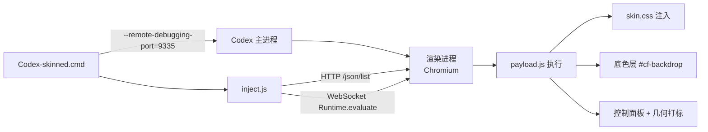

# Codex Frosted Glass

[](https://github.com/ISkywalkerI/codex-frosted-glass/releases/latest)
[](LICENSE)
[](#环境要求)
[](https://nodejs.org)

给 [Codex](https://openai.com/codex/) 桌面端（Windows / Electron）加一层**可调透明度的磨砂玻璃皮肤**。

不修改安装包、不破坏数字签名、随时可一键还原 —— 所有样式都在运行时注入，给根元素加一个 class 就完全恢复原样。

> 这是一个**第三方个人项目**，与 OpenAI 无关。仅改变本机客户端的视觉外观，不涉及账号、网络或任何数据。

[简体中文] · **English** → [README.en.md](README.en.md)



<p align="center">
  
  
</p>

---

## 特性

- **可调透明度**：右下角面板拖动滑块即刻生效，无需刷新
- **玻璃分层**：外壳、输入框、侧边栏三层不同厚度，形成前后关系
- **零常驻进程**：双击入口 → 启动并注入 → 进程退出。平时不占任何资源
- **可逆**：`◐` 按钮或给 `<html>` 去掉/加上 `cf-off` 类即可在皮肤/原版之间切换
- **不改系统**：不写注册表、不开机自启、不装服务、无遥测

## 原理



Chromium 只在启动参数里带 `--remote-debugging-port` 时才开放调试接口，这是唯一能不碰安装包就进入渲染进程的入口。注入器做完事就退出，皮肤的日常维持靠**页面内的 `MutationObserver`**，不需要后台进程。

### 为什么不做「真·桌面透视」

很多人对磨砂玻璃的期待是「能看见背后的桌面壁纸」。这在 Windows 10 上做不到：

- Codex 底层走 Electron 的 `backgroundMaterial: "mica"`，而 **Mica 是 Windows 11 独占**；Win10 上系统直接忽略，应用自动回落到不透明窗口（`html.electron-opaque`）
- 实测 Win10 的 DWM 亚克力（`SetWindowCompositionAttribute`，调用返回成功）**无法让模糊穿透 Electron 的不透明窗口**，画面仍是实心色块
- 唯一办法是重打包 `app.asar` 改窗口属性 —— 会破坏 MSIX 签名和自动更新，不值得

所以本项目只做**透明度**：在应用内部画一层平滑的氛围渐变当底色，再把「实心表面」令牌换成半透明混色。没有任何模糊，视觉上可逆。

### 为什么不做模糊

透明度调好之后，v1.7 / v1.8 试过加 `backdrop-filter: blur()`，最后**在 v1.9 移除了**。原因很直接：

- **背后没有可模糊的东西。** 玻璃后面只有我们自己画的一层平滑渐变，而模糊只吃掉高频细节 —— 把 blur 从 0 拉到 60，实测整屏平均像素差只有 **0.39%**，滑块等于坏的。
- **唯一的补救是造假。** v1.8 曾往背后塞一张多尺度散景图（光点 + 光斑），让模糊"有事可做"。但那是为了喂饱一个本不该存在的参数：多一层 DOM、多一层 SVG、多一层 GPU 的全窗模糊开销，换来的只是一个假效果。
- **真正能透视桌面模糊的做法在 Win10 上不存在**（见上），而全窗 `blur(38px)` 恰恰是滚动和流式输出时最贵的操作。

结论：**只保留透明度**。少一个滑块，少一层滤镜，画面一样好看，开销归零。

## 环境要求

| 项目 | 要求 |
|---|---|
| 系统 | Windows 10 / 11 x64 |
| 客户端 | Codex 桌面端（MSIX 打包的 Electron，入口 `ChatGPT.exe`） |
| 运行时 | Node.js ≥ 18（无任何 npm 依赖） |
| 端口 | 本地 `9335`（可用环境变量 `CDP_PORT` 改） |

## 快速开始

**方式 A — 下载 Release**（不需要 git）：从 [Releases](https://github.com/ISkywalkerI/codex-frosted-glass/releases/latest) 下载 `codex-frosted-glass-v1.9.0.zip`，解压到**固定目录**，双击 `Codex-skinned.cmd`。

**方式 B — clone**：

```bat
git clone https://github.com/ISkywalkerI/codex-frosted-glass.git
```

把文件夹放在**固定位置**（不要放在临时目录），然后双击：

```
Codex-skinned.cmd
```

它会根据当前状态自动处理：

| 当前状态 | 行为 |
|---|---|
| Codex 没运行 | 带调试端口启动 → 等界面加载 → 注入 → 退出（约 8–12 秒） |
| 已开着皮肤版 | 立即重新注入，1 秒内退出 |
| 开着原版（无端口） | 询问是否重启它，回车即接管 |
| 只有一个已经跑了很久的实例 | 不打断，提示你手动处理 |

想用**原版**时，照常点 Codex 自己的图标即可，两者互不影响。

### 命令行用法

```bash
node inject.js --open      # 确保以皮肤模式运行并注入一次，然后退出（推荐）
node inject.js --once      # 只注入当前实例，不启动
node inject.js --restart   # 强制重启并注入
node inject.js             # 守护模式：页面刷新/重启后自动重注入（常驻）
```

## 使用

注入成功后右下角会出现控制面板：

| 操作 | 效果 |
|---|---|
| 拖「透明」滑块 | 0% 完全不透明 → 100% 几乎全透 |
| 拖标题栏 | 移动面板（位置会记住） |
| `◐` | 开 / 关皮肤（关掉即刻还原原版外观） |
| `–` | 收起 / 展开面板 |
| `Ctrl + Shift + G` | 隐藏 / 显示面板（截图时有用） |

设置存放在 `localStorage["cf-glass-v1"]`，默认 `透明 55%`。

## 实现细节

### 1. 设计令牌透明化

Codex 的界面几乎完全由 CSS 变量驱动，所以不去逐个挑 DOM 节点，而是直接把这些「实心表面」令牌换成带 alpha 的混色：

```css
--color-token-main-surface-primary:
  color-mix(in srgb, #011627 calc(var(--cf-alpha) * 100%), transparent);
```

一次改动，所有引用这些令牌的面板同时变成半透明。共处理了 20 多个令牌（`--color-surface*`、`--app-color-background-*`、`--app-shell-*` 等）。

### 2. 三层厚度

| 层 | 处理 |
|---|---|
| 外壳 `#root` | 底色 × 0.62 alpha，整窗一片半透明玻璃，顶部一条内高光 |
| 输入框 | `alpha × 1.18` + 顶部 1px 内高光 + 投影（像一块凸起的玻璃） |
| 侧边栏 | 右侧 1px 亮边，比外壳更薄、更通透 |

### 3. 几何特征打标，不依赖类名

Codex 的类名带哈希（如 `ComposerLayoutBody-uBBf1A`），一升级就变。所以改用几何特征定位：

- **输入框**：从 `textarea` / `contenteditable` 向上最多 7 层，找第一个「圆角 ≥ 8px、宽 ≥ 220、高 ≥ 36」的祖先
- **侧边栏**：`#root` 内找「贴左边 ≤ 4px、高 ≥ 82% 视口、宽 180 ~ min(520, 42% 视口)」的元素

### 4. 参数计算

```js
alpha = 1 - (t / 100) * 0.94      // t=0 → 1.0（不透明），t=100 → 0.06
```

只有一个变量 `--cf-alpha`，所有 `color-mix` 都引用它，改它等于让浏览器整体重算，所以拖动是实时的。

## 开销

实测（22 个 Codex 进程，20 秒采样窗口）：

| 状态 | CPU（单核） | 说明 |
|---|---|---|
| 皮肤关闭 | 0.16% | 基线 |
| 皮肤开启 | 0.16% | **无差别**，只是静态的半透明底色 |
| 注入进程 | 双击后存在数秒 | 注入完成后退出，平时为 0 |

因为没有任何 `backdrop-filter`，滚动、拖窗口、AI 流式输出时**不需要每帧重新模糊**，这是 v1.9 砍掉模糊后最实在的收益。

## 已知限制

- **页面重载会丢皮肤**。样式注入在当前页面，Codex 刷新或重开窗口后消失，再双击一次入口即可。想自动维持就用 `node inject.js`（守护模式，常驻约 57 MB 内存）
- **必须以带端口的方式启动**才能注入，直接点原来的图标不会生效（这是 Chromium 的设计）
- Windows 10 无法实现桌面透视，见上文
- 界面大改版后几何打标可能失配，日志里会显示 `输入框× 侧栏×`，需要调整 `payload.js` 的阈值

## 排错

| 现象 | 原因 / 处理 |
|---|---|
| 双击后闪退或 `MODULE_NOT_FOUND` | 脚本被移动了。`cd` 到 `inject.js` 所在目录再运行，或设置 `CF_HOME` 环境变量 |
| `无法连接到 Codex 调试端口` | Codex 已以原版方式运行很久。完全退出后重试，或 `node inject.js --restart` |
| 注入成功但界面没变化 | 面板可能被隐藏，按 `Ctrl+Shift+G`；或皮肤被关掉，点 `◐` |
| 界面变全透明看不清字 | 透明度调太高，把「透明」滑块拖回 40–60% |
| 升级 Codex 后失效 | 类名/令牌可能变了，看控制台日志定位 |

## 目录结构

```
codex-frosted-glass/
├─ Codex-skinned.cmd     # 一键入口（双击）
├─ inject.js             # 启动器 + CDP 注入
├─ payload.js            # 渲染进程内执行：注入样式、建面板、打标
├─ skin.css              # 全部玻璃样式（含可调变量）
├─ cdp.js                # 极简 CDP 客户端（调试用）
├─ capture.js            # 渲染进程内截图（不受窗口遮挡影响）
├─ codex-skinned.ico     # 渐变底图标（16–256 六档）
└─ docs/                 # 预览图
```

## 卸载 / 还原

1. 关闭 Codex
2. 删除本文件夹
3. 已注入的样式随进程结束消失，客户端回到原样

没有写注册表、没有开机自启、没有系统服务。想确认干净：`ls "%APPDATA%\Microsoft\Windows\Start Menu\Programs\Startup"` 不应出现本项目相关文件。

## 许可与声明

代码以 [MIT](LICENSE) 发布。

- **Codex / ChatGPT 是 OpenAI 的商标**。`codex-skinned.ico` 中的白色标志取自本机已安装客户端的磁贴素材，仅用于标识被启动的应用，商标权归 OpenAI 所有。如权利人要求，可删除该文件，图标可自行替换。
- 本项目不包含、不分发 OpenAI 的任何程序代码，只在运行时读取本机已安装应用的渲染层。
- 使用本项目的风险由使用者自行承担。

---

<sub>Renders as: a runtime-injected, fully reversible frosted-glass skin for the Codex desktop app on Windows. No binary patching, no background daemon, no telemetry.</sub>
