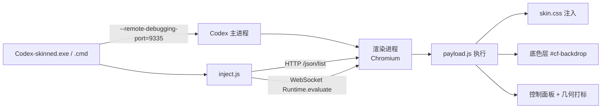

# Codex Frosted Glass

[](https://github.com/ISkywalkerI/codex-frosted-glass/releases/latest)
[](LICENSE)
[](#环境要求)
[](https://nodejs.org)

给 [Codex](https://openai.com/codex/) 桌面端（Windows / Electron）加一层**透明度可调、配色可换的磨砂玻璃皮肤**。

不修改安装包、不破坏数字签名、随时可一键还原 —— 所有样式都在运行时注入，给根元素加一个 class 就完全恢复原样。

> 这是一个**第三方个人项目**，与 OpenAI 无关。仅改变本机客户端的视觉外观，不涉及账号、网络或任何数据。

[简体中文] · **English** → [README.en.md](README.en.md)


---

## 特性

- **双击即用，两个入口**：`Codex-skinned.exe` 图标已内嵌、无控制台窗口，可以直接固定到开始屏幕 / 任务栏；想看到完整输出就换成 `Codex-skinned.cmd`
- **可调透明度**：右下角面板拖动滑块即刻生效，无需刷新
- **渐变配色自选**：面板内 HSV 色环挑主光 / 副光 / 底色，其余 3 盏光晕与玻璃底色自动派生；5 套预设一键切换，不满意点「重置配色」回到默认
- **玻璃分层**：外壳、输入框、侧边栏三层不同厚度，形成前后关系；输入框固定 97% 的底，打字时背后正文不会透上来
- **零常驻进程**：双击入口 → 启动并注入 → 进程退出。平时不占任何资源
- **可逆**：`◐` 按钮或给 `<html>` 去掉/加上 `cf-off` 类即可在皮肤/原版之间切换
- **不改系统**：不写注册表、不开机自启、不装服务、无遥测

## 原理



Chromium 只在启动参数里带 `--remote-debugging-port` 时才开放调试接口，这是唯一能不碰安装包就进入渲染进程的入口。注入器做完事就退出，皮肤的日常维持靠**页面内的 `MutationObserver`**，不需要后台进程。

### 为什么不做「真·桌面透视」

很多人对磨砂玻璃的期待是「能看见背后的桌面壁纸」。这在 Windows 10 上做不到：

- Codex 底层走 Electron 的 `backgroundMaterial: "mica"`，而 **Mica 是 Windows 11 独占**；Win10 上系统直接忽略，应用自动回落到不透明窗口（`html.electron-opaque`）
- 实测 Win10 的 DWM 亚克力（`SetWindowCompositionAttribute`，调用返回成功）**无法让模糊穿透 Electron 的不透明窗口**，画面仍是实心色块
- 唯一办法是重打包 `app.asar` 改窗口属性 —— 会破坏 MSIX 签名和自动更新，不值得

所以本项目只做**透明度**：在应用内部画一层平滑的氛围渐变当底色，再把「实心表面」令牌换成半透明混色。没有任何模糊，视觉上可逆。

### 为什么不做模糊

透明度调好之后，v1.7 / v1.8 试过加 `backdrop-filter: blur()`，最后**在 v1.9 移除了**。原因很直接：

- **背后没有可模糊的东西。** 玻璃后面只有我们自己画的一层平滑渐变，而模糊只吃掉高频细节 —— 把 blur 从 0 拉到 60，实测整屏平均像素差只有 **0.39%**，滑块等于坏的。
- **唯一的补救是造假。** v1.8 曾往背后塞一张多尺度散景图（光点 + 光斑），让模糊"有事可做"。但那是为了喂饱一个本不该存在的参数：多一层 DOM、多一层 SVG、多一层 GPU 的全窗模糊开销，换来的只是一个假效果。
- **真正能透视桌面模糊的做法在 Win10 上不存在**（见上），而全窗 `blur(38px)` 恰恰是滚动和流式输出时最贵的操作。

结论：**只保留透明度**。少一个滑块，少一层滤镜，画面一样好看，开销归零。

## 环境要求

| 项目 | 要求 |
|---|---|
| 系统 | Windows 10 / 11 x64 |
| 客户端 | Codex 桌面端（MSIX 打包的 Electron，入口 `ChatGPT.exe`） |
| 运行时 | Node.js ≥ 18（无任何 npm 依赖） |
| 重新打包 exe | 仅修改启动器后才需要 Python 3.9+ 与 PyInstaller（日常使用不需要） |
| 端口 | 本地 `9335`（可用环境变量 `CDP_PORT` 改） |

## 快速开始

**① 下载 Release**（不需要 git）：从 [Releases](https://github.com/ISkywalkerI/codex-frosted-glass/releases/latest) 下载 `codex-frosted-glass-v1.12.4.zip`，解压到**固定目录**。

**② clone 仓库**（想改代码或跟更新）：

```bat
git clone https://github.com/ISkywalkerI/codex-frosted-glass.git
```

> 不要把文件夹放在临时目录 —— 启动器要靠自身位置去找同目录的 `inject.js`。

### 两种打开方式

拿到文件夹后，有**两个入口，做的事完全一样**（都是 `node inject.js --open`），按场景选一个：

| 入口 | 形态 | 什么时候用 |
|---|---|---|
| **`Codex-skinned.exe`**（推荐） | 无控制台窗口；图标、版本信息已写进 PE，可以固定到开始屏幕 / 任务栏 | 日常使用，双击即可 |
| **`Codex-skinned.cmd`** | 带控制台窗口，完整输出直接打在窗口里 | 排错；或 exe 被安全软件拦下、双击没反应时的替代入口 |

#### 首次运行的安全提示（都是正常现象）

- **SmartScreen 拦截**：exe 没有做数字签名，Windows 会弹「Windows 已保护你的电脑」→ 点 **「更多信息」→「仍要运行」**。只需放行一次，之后不再打扰。
- **杀软误报**：极少数安全软件会对 PyInstaller 单文件打包的 exe 报毒。遇到了就**把整个文件夹加入白名单**，或者干脆**改用 `Codex-skinned.cmd` 打开** —— 它不经过 exe，只用你本机已装好的 `node` 跑脚本。
- 这两条都与皮肤本身无关：exe 里只有启动器的几十行 Python 代码，皮肤逻辑全在明文可读的 `inject.js` / `payload.js` / `skin.css` 里。

启动后它会根据当前状态自动处理：

| 当前状态 | 行为 |
|---|---|
| Codex 没运行 | 带调试端口启动 → 等界面加载 → 注入 → 退出（约 8–12 秒） |
| 已开着皮肤版 | 立即重新注入，1 秒内退出 |
| 开着原版（无端口） | 弹窗问是否重启它，选「是」即接管 |
| 只有一个已经跑了很久的实例 | 不打断，提示你手动处理 |

想用**原版**时，照常点 Codex 自己的图标即可，两者互不影响。

### 命令行用法

```bash
node inject.js --open      # 确保以皮肤模式运行并注入一次，然后退出（推荐）
node inject.js --once      # 只注入当前实例，不启动
node inject.js --restart   # 强制重启并注入
node inject.js             # 守护模式：页面刷新/重启后自动重注入（常驻）
```

`Codex-skinned.exe` 与 `Codex-skinned.cmd` 都接受这些参数并原样透传，例如 `Codex-skinned.exe --restart`。

## 使用

调节面板**默认隐藏**（不挡视线），按 `Ctrl + Shift + G` 调出。**每次以皮肤模式打开**，窗口顶部都会先亮一条 5 秒的提示告诉你这个快捷键，然后自动消失 —— 面板开着时提示文字会改成怎么隐藏它，所以不会出现「面板已经在却还在告诉你按什么调出来」的错位：

| 操作 | 效果 |
|---|---|
| 拖「透明」滑块 | 0% 完全不透明 → 100% 几乎全透 |
| 点 5 个预设色块 | 一键换整套配色（极光紫 / 深海蓝 / 落日橙 / 森林绿 / 灰玻璃） |
| 点 主光 / 副光 / 底色 | 切换色轮当前编辑的颜色 |
| 拖色轮色环 | 改色相（环上圆点跟随） |
| 拖色轮中间方块 | 改饱和度 / 明度（水平 = 饱和度，垂直 = 明度） |
| hex 框 / R G B 框 | 精确输入；底色过亮会自动压暗以保证可读 |
| 拖标题栏 | 移动面板（位置会记住） |
| `◐` | 开 / 关皮肤（关掉即刻还原原版外观） |
| `–` | 收起 / 展开面板 |
| **重置配色** | 三种颜色一键回到默认极光紫（不影响透明度）；已经是默认配色时按钮置灰 |
| `Ctrl + Shift + G` | 显示 / 隐藏调节面板（默认隐藏；每次打开会提示 5 秒） |

设置存放在 `localStorage["cf-glass-v1"]`，默认 `透明 55%`、配色为极光紫（`#883ff1` · `#3566f0` · `#0b1728`，即 v1.9 的观感）。

**改动是即时保存的**：拖完色轮松手（或点完预设）就立刻落盘，不必点保存。关闭 Codex 后下次以皮肤模式打开，仍是上次的透明度和配色；页内刷新会掉皮肤（见「已知限制」），但再双击一次入口就恢复成你调过的样子。

### 不只是对话页

皮肤作用于整套界面，设置、通知、数据管理这些二级页面同样是分层玻璃 —— 底下的输入框、侧栏也各自保持不同的玻璃厚度：


## 实现细节

### 1. 设计令牌透明化

Codex 的界面几乎完全由 CSS 变量驱动，所以不去逐个挑 DOM 节点，而是直接把这些「实心表面」令牌换成带 alpha 的混色：

```css
--color-token-main-surface-primary:
  color-mix(in srgb, #011627 calc(var(--cf-alpha) * 100%), transparent);
```

一次改动，所有引用这些令牌的面板同时变成半透明。共处理了 20 多个令牌（`--color-surface*`、`--app-color-background-*`、`--app-shell-*` 等）。

**有个坑值得单独说**：Codex 会把**前景色**别名到某个背景令牌上 —— `--color-text-composer-primary` 与 `--color-text-primary-solid` 都指向 `--color-background-control-opaque`。这个「控件底色」一旦被改成 7% 透明，浅色发送键上的箭头也跟着透明，整颗按钮看起来就是**全白**的（v1.12.2 及以前的 bug）。

所以规则是：**背景令牌可以透明化，前景令牌不行**。这两个前景令牌在深色主题里的原始值就是 `#0b1728`，skin.css 里单独钉回去；用同一令牌当背景的 70 多个控件（下拉菜单、气泡等）仍然保持半透明，玻璃感不受影响：

```css
:root:not(.cf-off) {
  --color-text-composer-primary: #0b1728;
  --color-text-primary-solid: #0b1728;
}
```

**第二个坑：这台机器上 `backdrop-filter` 是失效的。** 一度试过「给输入框加 26px 背模糊」来救可读性，结果毫无变化；做对照实验（把底降到 18%、模糊加到 30px），背后正文依旧笔画清晰 —— 也就是说指望模糊把文字糊开这条路走不通，只能靠不透明度。v1.9 删掉模糊是对的选择，但没有模糊之后，「玻璃」和「能读」只能二选一，于是输入框靠不透明度解决（97%）。

### 2. 三层厚度

| 层 | 处理 |
|---|---|
| 外壳 `#root` | 底色 × 0.62 alpha，整窗一片半透明玻璃，顶部一条内高光 |
| 输入框 | **固定 97% 的底**（不参与透明度滑块）+ 顶部 1px 内高光 + 外投影，像一块压在正文上的厚玻璃 |
| 侧边栏 | 右侧 1px 亮边，比外壳更薄、更通透 |

输入框是唯一「边打字边读字」的表面，所以它不吃透明度滑块，固定 97%：透明度 100%（alpha 0.06）时，7% 的底会让背后正文原样透进输入区，和正在输入的字叠在一起，分不清哪行是自己的。实测 86% 仍能读出背后的标题，96% 只剩隐约横线，99% 才彻底干净 —— 97% 是「字句看不见、但还看得出是块玻璃」的那一档，玻璃感由内高光、一圈亮边和投影补足。

### 3. 几何特征打标，不依赖类名

Codex 的类名带哈希（如 `ComposerLayoutBody-uBBf1A`），一升级就变。所以改用几何特征定位：

- **输入框**：从 `textarea` / `contenteditable` 向上最多 9 层，找第一个「圆角 ≥ 8px、宽 ≥ 220、高 ≥ 36」的祖先（输入框容器正好在第 7 层 —— 以前的循环写成 `hop < 7`，差一跳从没命中过）
- **侧边栏**：`#root` 内找「贴左边 ≤ 4px、高 ≥ 82% 视口、宽 180 ~ min(520, 42% 视口)」的元素

### 4. 参数计算

```js
alpha = 1 - (t / 100) * 0.94      // t=0 → 1.0（不透明），t=100 → 0.06
```

只有一个变量 `--cf-alpha`，所有 `color-mix` 都引用它，改它等于让浏览器整体重算，所以拖动是实时的。唯一不吃它的是输入框的底（见上一节的「三层厚度」）。

### 5. 渐变参数化与配色派生

背景是 6 层：5 个角部光晕 + 1 个全局线性渐变。用户只调 3 个颜色，其余全部派生。

**变量用裸 `r, g, b` 三元组**，而不是 hex：

```css
:root { --cf-c-main: 136, 63, 241; /* … */ }
#cf-backdrop {
  background: radial-gradient(…, rgba(var(--cf-c-main), 0.42), transparent 62%), /* … */;
}
```

这样样式表自带默认值（JS 不跑也是今天的画面），每层的 alpha 仍留在 CSS 里逐层微调，并且与既有 `rgb(var(--cf-tint))` 的写法一致。**把三元组换成 hex 是唯一能一次搞坏整块背景的改法**——`rgba(var(--x), .42)` 会变成 invalid at computed-value time，整条 `background` 回退成 `none`。

派生规则：

| 层 | 来源 |
|---|---|
| L1 左上 `.42` | 主光直出 |
| L2 右上 `.30` | 副光直出 |
| L3 右下 `.32` | 主副光按 5:5 混色，压到 `s=0.30 / l=0.45` |
| L4 左下 `.16` | 主副光按 7:3 混色，压到 `s=0.42 / l=0.50` |
| L5 中心 `.06` | 主副光按 3:7 混色，压到 `s=0.85 / l=0.42` |
| L6 底 `.1` | 选中底色 + 两个固定偏移停靠点（`-4,-8,-12` / `-3,-4,-9`） |

用「混色 + 固定饱和度/明度」而不是按色相增量旋转，是为了保证任何配色下三盏光晕都和主副光同调 —— 早期版本用色相增量，在「落日橙」里算出了一盏绿光。

`--cf-tint`（玻璃片底色）由底色 × 0.85 + 主光偏移 × 0.08 派生，并夹到 0–60，保证始终是深色（它同时是 `#root` 和输入框的填充色，亮了就没有文字对比度）。

两个兜底：
- 主副光都是默认值时，三盏光晕直接取原硬编码值 —— 只改底色不会扰动光晕
- 三色全是默认值时，10 个变量全部 `removeProperty`，画面与 v1.9 逐字节一致
- 底色亮度超过 `L=0.30` 时统一压回 0.30（保持色相/饱和度比例）

## 开销

实测（22 个 Codex 进程，20 秒采样窗口）：

| 状态 | CPU（单核） | 说明 |
|---|---|---|
| 皮肤关闭 | 0.16% | 基线 |
| 皮肤开启 | 0.16% | **无差别**，只是静态的半透明底色；换配色只在点击/拖动时写 10 个 CSS 变量 |
| 注入进程 | 双击后存在数秒 | 注入完成后退出，平时为 0 |

因为没有任何 `backdrop-filter`，滚动、拖窗口、AI 流式输出时**不需要每帧重新模糊**，这是 v1.9 砍掉模糊后最实在的收益。

### 6. exe 启动器

`Codex-skinned.exe` 不是把 `.cmd` 包了一层壳，而是一个独立程序（源码 `launcher/launcher.py`，用 PyInstaller 打成单文件）：

1. 找 `inject.js`（先看自己所在目录，再看 `CF_HOME`）和 `node.exe`（`CF_NODE` → PATH → 常见安装位置）
2. 跑 `node inject.js --probe`，**只看退出码**判断当前状态，不做任何改动
3. Codex 在跑但没开调试端口时先弹窗问一句要不要重启 —— 普通 cmd 在非交互环境下会直接替你重启，可能弄丢正在输入的内容
4. 真正执行 `node inject.js --open`，输出写进日志而不是控制台

`--probe` 的退出码是启动器和 `inject.js` 之间的约定：

| 退出码 | 含义 | 启动器行为 |
|---|---|---|
| 0 | 调试端口可用 | 直接注入 |
| 3 | Codex 在跑但没开端口 | 弹窗确认，同意后加 `--yes` |
| 4 | Codex 没在跑 | 直接启动并注入 |

日志固定在 `%LOCALAPPDATA%\CodexSkinned\launcher.log`（每次运行覆盖），失败时日志尾部会直接显示在对话框里。图标和版本信息是打包时写进 PE 资源的，所以它能像正常应用一样固定到开始屏幕 —— `.cmd` 被系统归类为文档，没有这个选项。

## 已知限制

- **页面重载会丢皮肤**。样式注入在当前页面，Codex 刷新或重开窗口后消失，再双击一次入口即可。想自动维持就用 `node inject.js`（守护模式，常驻约 57 MB 内存）
- **必须以带端口的方式启动**才能注入，直接点原来的图标不会生效（这是 Chromium 的设计）
- Windows 10 无法实现桌面透视，见上文
- 界面大改版后几何打标可能失配，日志里会显示 `输入框× 侧栏×`，需要调整 `payload.js` 的阈值
- **底色选得过亮会被自动压暗**（亮度上限 30%），否则正文会糊在背景上。hex 框里仍显示你输入的原值，色靶显示的是压暗后的实际颜色
- **改 `skin.css` / `payload.js` 后必须重新注入**：这两个文件是注入进程启动时读入的字符串，不重跑入口不会生效
- **exe 没有数字签名**：首次运行会有 SmartScreen 提示（「更多信息」→「仍要运行」）；个别安全软件对 PyInstaller 单文件有误报，遇到就加白名单，或改用 `Codex-skinned.cmd` / `node inject.js` —— 详见[「两种打开方式」](#两种打开方式)
- **exe 有 8.4 MB**：为了在任何机器上双击即跑，它自带一份 Python 运行时；皮肤本身仍然只是几十 KB 的 CSS/JS

## 排错

| 现象 | 原因 / 处理 |
|---|---|
| 双击后闪退或 `MODULE_NOT_FOUND` | 脚本被移动了。`cd` 到 `inject.js` 所在目录再运行，或设置 `CF_HOME` 环境变量 |
| `无法连接到 Codex 调试端口` | Codex 已以原版方式运行很久。完全退出后重试，或 `node inject.js --restart` |
| 注入成功但界面没变化 | 面板可能被隐藏，按 `Ctrl+Shift+G`；或皮肤被关掉，点 `◐` |
| 界面变全透明看不清字 | 透明度调太高，把「透明」滑块拖回 40–60% |
| 换了颜色但背景没变 | 可能是改了 `skin.css` / `payload.js` 却没重新双击入口（样式是启动时读进内存的字符串） |
| 面板跑到屏幕外 | 已按面板实际高度自动钳制；若仍越界，把它拖回窗口内即可（位置会被记住） |
| 升级 Codex 后失效 | 类名/令牌可能变了，看控制台日志定位 |
| 双击 exe 没反应也没弹窗 | 看 `%LOCALAPPDATA%\CodexSkinned\launcher.log`；日志也没有，多半是 exe 被安全软件拦了 |
| 提示「Windows 已保护你的电脑」 | exe 未签名的正常提示：更多信息 → 仍要运行 |
| 发送键变成一颗「全白」的圆、箭头看不见 | 前景令牌被当背景令牌透明化了（详见「实现细节 1」）；v1.12.2 已修，旧版更新即可 |
| 输入框里的字和背后正文糊在一起 | v1.12.3 起输入框固定 97% 的底、不再跟随透明度；旧版更新即可 |

## 目录结构

```
codex-frosted-glass/
├─ Codex-skinned.exe      # 双击入口（图标已内嵌，推荐）
├─ Codex-skinned.cmd      # 同上的控制台版本（排错用）
├─ inject.js              # 启动器 + CDP 注入
├─ payload.js             # 渲染进程内执行：注入样式、建面板、打标
├─ skin.css               # 全部玻璃样式（含可调变量）
├─ cdp.js                 # 极简 CDP 客户端（调试用）
├─ capture.js             # 渲染进程内截图（不受窗口遮挡影响）
├─ Codex-skinned_icon.ico # 渐变底图标（16 / 24 / 32 / 48 / 64 / 128 / 256 七档）
├─ launcher/              # exe 的源码与打包脚本（launcher.py / version.txt / build.cmd）
└─ docs/                  # 展示图 screenshot.jpg / screenshot2.jpg
```

## 卸载 / 还原

1. 关闭 Codex
2. 删除本文件夹
3. 已注入的样式随进程结束消失，客户端回到原样

没有写注册表、没有开机自启、没有系统服务。想确认干净：`ls "%APPDATA%\Microsoft\Windows\Start Menu\Programs\Startup"` 不应出现本项目相关文件。

## 许可与声明

代码以 [MIT](LICENSE) 发布。

- **Codex / ChatGPT 是 OpenAI 的商标**。`Codex-skinned_icon.ico` 中的白色标志取自本机已安装客户端的磁贴素材，仅用于标识被启动的应用，商标权归 OpenAI 所有。如权利人要求，可删除该文件，图标可自行替换。
- 本项目不包含、不分发 OpenAI 的任何程序代码，只在运行时读取本机已安装应用的渲染层。
- 使用本项目的风险由使用者自行承担。

---

<sub>Renders as: a runtime-injected, fully reversible frosted-glass skin for the Codex desktop app on Windows. No binary patching, no background daemon, no telemetry.</sub>
